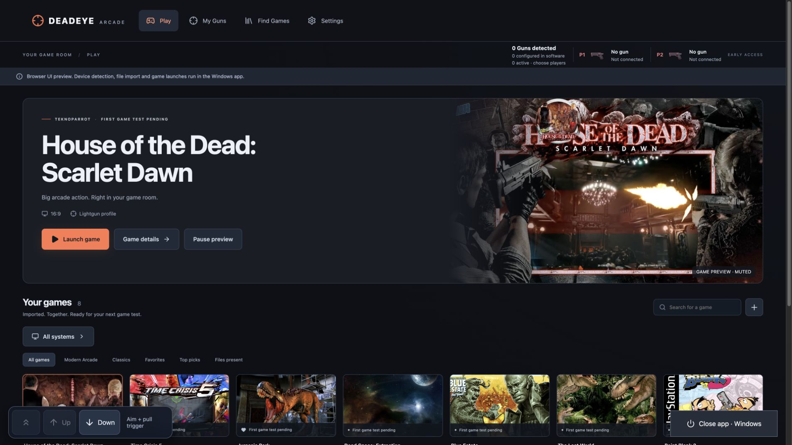
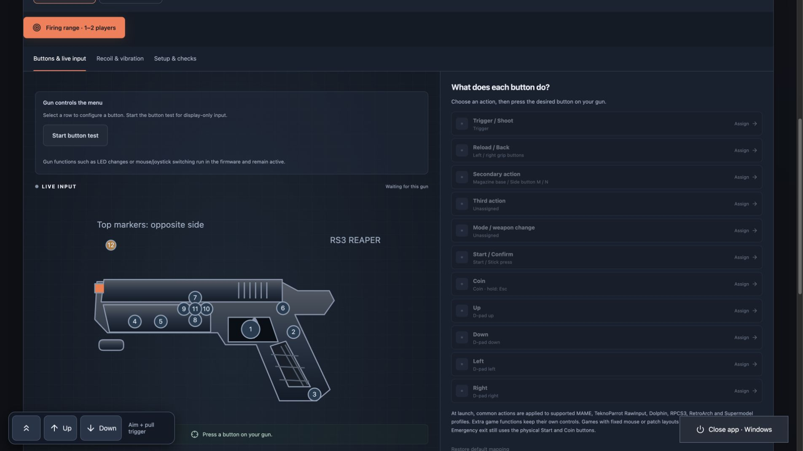
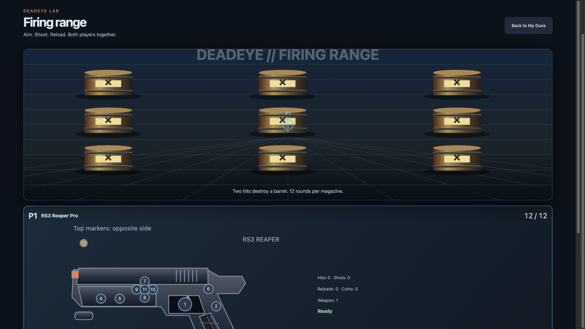

# Deadeye Arcade


**Your lightguns. Your games. One Windows arcade.**

Browse your games, choose your guns and play from one fullscreen interface.
Deadeye prepares supported emulator profiles, checks common setup problems and
brings you back to your library when a game ends.

[](https://github.com/sthamann/deadeye-arcade/releases/latest)
[](LICENSE)
[](#language)

**[Download for Windows](https://github.com/sthamann/deadeye-arcade/releases/latest)** ·
[Portable app and checksums](https://github.com/sthamann/deadeye-arcade/releases) ·
[Setup guide](#get-started)



## From setup to play

- **Browse with your gun.** Covers, video previews, screenshots, favorites and
  platform filters in a library made for the big screen. Aim and pull the trigger,
  use your stick or D-pad, or select the fixed scrolling buttons.
- **Choose P1 and P2.** Assign connected guns, mix supported models and let extra
  devices sit out. Saved settings belong to each physical gun and survive updates
  and reconnects.
- **Understand every button.** Gun Studio shows model illustrations, live button
  highlights, guided input capture and editable action bindings.
- **Try your setup immediately.** The built-in firing range has destructible
  barrels, separate player crosshairs, ammunition, reloads and live control feedback.
- **Prepare supported games.** Input adapters use the selected guns, runtime
  inspection finds missing dependencies, and reviewed repairs handle known path,
  profile and presentation problems.
- **Keep a way back.** A startup controls guide, in-game menu, independent emergency
  exit and persistent **Close app · Windows** button keep navigation within reach.


[Watch the library recording](docs/images/deadeye-library.mp4)

Screenshots and recordings show the current frontend in English with a curated
media selection. Browser previews demonstrate the interface; they do not establish
physical gun or game compatibility. Games and original media are not bundled.
Game artwork belongs to its respective owners.

## Get started

1. **Install Deadeye Arcade.** The Windows installer adds desktop and Start menu
   shortcuts. The .NET runtime is included; Setup installs Microsoft Edge WebView2
   Runtime when needed.
2. **Open My Guns.** Assign a gun to P1 and optionally P2. Prepare its supported
   software, inspect live buttons and capture any unknown controls.
3. **Calibrate at your physical screen.** Use the model's calibration workflow,
   then check both players in the firing range.
4. **Import your games.** Use **Find Games** for TeknoParrot profiles, supported
   MAME scanning, Windows applications or a collection JSON. Add local covers,
   videos, screenshots and logos; cover downloads can use a SteamGridDB API key.
5. **Launch and play.** Deadeye prepares supported profiles and shows the game's
   current controls. Confirm aiming, required actions and separate P2 input in the
   game before marking gameplay tested.

Fullscreen is enabled by default. **Settings** lets you enable Windows startup,
change language and control optional desktop crosshairs. Windows startup is off
by default; desktop crosshairs have their own startup setting.

Games, ROMs, emulators and manufacturer utilities are supplied separately.
Vendor subscriptions, matching multiplayer patches and physical calibration may
be required. The current installer and portable app are not code-signed.

### Language

**English is the default.** Switch between English and German in
**Settings → Language**. This covers the frontend, native menus, dialogs and app
messages. Your choice survives restarts and updates. External manufacturer and
emulator interfaces retain their own language.

## Supported lightguns

| Model | Controls and setup integration |
| --- | --- |
| **RS3 Reaper Pro** | Trigger, grip reload, magazine base, Start/Coin and stick controls. Windows HID/COM detection, integrated manufacturer calibration, aspect/offscreen settings and separate recoil/rumble tests. |
| **Sinden Lightgun** | Trigger, pump, four side buttons and D-pad. Manufacturer software preparation, runtime checks, guided capture and supported game profile routing. Sinden software supplies camera tracking and the border. |
| **X-Gunner Wireless** | Receiver recognition, Start/Coin, stick navigation, mouse buttons and additional keyboard inputs. Manufacturer utility preparation, onboard calibration guidance and feedback tests. The documented magazine release is mechanical, without a separate documented HID input. |
| **Blamcon Vyper** | Trigger, A/B, magazine reload, Start/Select, stick directions and optional shared pedal channel. Supported firmware 2.x settings and button import, per-game configuration and official ARC access through Steam. ARC supplies camera diagnostics and calibration. |



**My Guns** distinguishes a connected device, prepared software, received buttons
and verified aiming. Detecting a USB device or wireless receiver does not establish
working tracking. Hardware calibration, feedback and each game's independent
player inputs still need a test at the physical screen.

For Vyper, match the actual IR positions in ARC: **2 Up 2 Down** for four corners
or two upper/two lower points; **Crosshair** only for points at the middle of all
four edges. Check the camera's Live View before calibrating. Responding buttons
alone do not confirm that the camera sees the emitters.

[Model setup and default controls](docs/lightgun-setup.md) ·
[Physical button reference](docs/HARDWARE-CONTROLS.md) ·
[Gun Studio walkthrough](docs/gun-studio.md)

## Try your guns before a game

Open **My Guns → Firing range** to test shooting, reloads and additional actions
without installing a game. Each selected player has a separate crosshair,
magazine, score and control readout. Pressed buttons highlight the gun drawing;
received controls remain visible even when they have no assigned action.



The browser range is a mouse-operated demonstration. Connected gun tests use the
physical monitor. Range effects do not certify a game's recoil integration.

## Profiles, dependencies and automatic repairs

Deadeye opens using the latest saved check results. It checks and repairs the
selected game before launch; a full library repair runs when you choose it in
Settings. Aim and button tests are optional and never required to launch a game.

At launch, Deadeye reads the selected physical guns and prepares supported game
input files. Common actions follow your saved bindings; additional functions such
as weapon change, grenades or pedals use reviewed title-specific routes. The
startup reference shows the resulting profile and any unresolved controls.

| Setup problem | Current behavior |
| --- | --- |
| Changed game or emulator locations | Repairs supported unambiguous paths and retains profile backups. |
| Selected P1/P2 guns | Writes supported device and action routes for the chosen pair, including supported mixed models. |
| Supported Wii titles | Applies matching disc-region accuracy profiles and independent input bridge channels. |
| Recognized multiplayer extensions | Configures matching installed integrations, including supported Blue Estate and HOTD 2: Remake paths. |
| Missing runtimes or support files | Inspects known dependencies and prepares matching reviewed official packages. Microsoft installers are checked for architecture and signature. |
| Linux arcade loaders and Unicode paths | Creates a physical ASCII game copy when required, preserves originals and reuses the prepared copy. Source updates propagate while unchanged player saves remain intact. |
| Duplicate starts and lingering processes | Reserves a single session and supervises the owned game and helper processes. |

Open **Settings → Automatic repairs** for findings, completed changes and next
steps. Existing configurations are backed up; unknown files and unsupported
requirements remain visible for review. Firmware flashes, factory resets,
Windows security policy changes and physical calibration are not automatic.

[Automatic repair guide](docs/automatic-repairs.md) ·
[Detailed profile routing](docs/lightgun-setup.md#how-gun-profiles-reach-your-games)

### Emulator support

| System | Integrated path | Additional setup to check |
| --- | --- | --- |
| **TeknoParrot** | Profile import, path repair, supported RawInput bindings and title-specific controls | Vendor access, installed game build, special actions and helper/output configuration |
| **MAME** | Lightgun catalog scan, controller mapping and control metadata checks | ROM compatibility, overrides and service calibration |
| **Dolphin / Wii** | Region-matched accuracy profiles and independent supported gun channels | Disc ID, captured controls, aiming and title-specific actions |
| **RetroArch** | Explicit player devices and supported core profiles | Core controls, overrides and shared keyboard inputs |
| **Flycast** | Per-device mouse/keyboard profiles for supported launch paths | Correct game content, emulator build and calibration |
| **Supermodel** | RawInput assignments and supported title overrides | Service calibration and simultaneous gameplay |
| **Standalone RPCS3** | Supported Raw Mouse / PS Move configuration | Compatible build and per-player game calibration |
| **Model 2** | Search paths, supported presentation and installed DemulShooter setup | Matching helper and service calibration |
| **PCSX2** | Portable storage repair, launch paths and shared-pointer detection | Independent two-gun support for the selected input path |
| **Other Windows games** | Application launch, configured helpers and runtime inspection | Matching plugins and game-specific input support |

**Early access:** setup integration is not a promise that every game and gun
combination has been played through. Launch checks, profile completeness,
physical aim, independent P2 input and feedback remain distinct results.
[Game-specific compatibility](docs/compatibility.md).

## Controls and returning to Windows

| Action | Control |
| --- | --- |
| Browse | Aim and trigger, stick/D-pad, or fixed scrolling buttons |
| Return from a game | Hold physical **Start + Coin/Select** for about **two seconds**; keyboard **F12** |
| Open the in-game menu | Hold the assigned trigger for **at least ten seconds**, then release; keyboard **F10** |
| Resume, restart or end a game | Select an in-game menu action |
| Close Deadeye | Select **Close app · Windows**; after returning from a game, release Start/Coin and hold them again in the frontend |

A ten-second controls introduction appears when the game window becomes visible.
Autofire can interrupt a trigger hold, so **Start + Coin/Select is the primary
emergency gesture**. Exit detection runs independently of the frontend UI thread.
Closing the app cancels pending launches. The in-game menu does not pause gameplay.
Exclusive fullscreen games can cover desktop overlays.

Optional desktop crosshairs show assigned P1/P2 aim positions over Desktop and
Explorer and hide over games. Windows retains one shared system click pointer.
[Overlay and exit details](docs/in-game-overlay.md).

## Check your library

The library check launches titles one at a time through the normal setup path,
checks the owned renderer, foreground focus and cleanup, then inspects supported
control profiles. The control simulator checks readable routes and player
separation without requiring a game launch. These checks retain unresolved
requirements and never mark physical gameplay as verified.

With the frontend closed, use `ReaperArcade.exe --test-library` for launch checks
or `ReaperArcade.exe --simulate-controls` for control checks. Resume, stop commands,
report formats and detailed coverage are documented in the
[library validation guide](docs/library-validation.md).

## Updates and your data

Deadeye checks stable GitHub releases at startup and every six hours. Use
**Settings → App updates → Install update and restart** to install an available
release. Downloads are checked against GitHub's SHA-256 digest and size. The
updater backs up the library and preserves games, mappings, language and startup
preferences. Updates wait until the current game has ended.

Settings, library entries and reports stay under `%LOCALAPPDATA%\ReaperArcade`.
The optional SteamGridDB API key uses Windows user-bound encryption and is excluded
from diagnostic exports. Repair and update checks do not upload your library or
gun data. Uninstall retains your library, settings and media.
[Installer and updater details](docs/updates.md).

## Build and contribute

Requires **Node.js** and **.NET SDK 10**. Node.js 24 or newer is needed for the
TypeScript range checks.

```sh
cd ui
npm ci
npm run build
cd ..
dotnet run --project src/Reaper.Checks -c Release
dotnet publish src/Reaper.Windows -c Release -r win-x64 --self-contained true -o release/windows-x64
```

Keep the complete publish output, including `web/`. Windows packaging uses
[build-windows.ps1](scripts/build-windows.ps1) and NSIS. The installed app is native
WPF with a packaged React/WebView2 interface; normal Windows use requires no local
web server.

[Architecture](docs/architecture.md) · [UI checks and localization](docs/localization.md) ·
[Media capture notes](docs/images/README.md) · [Branding](docs/branding.md)

## License

Deadeye Arcade's application code uses the **[MIT License](LICENSE)**.
Third-party components retain their own terms.
[Third-party notices](THIRD-PARTY.md).
