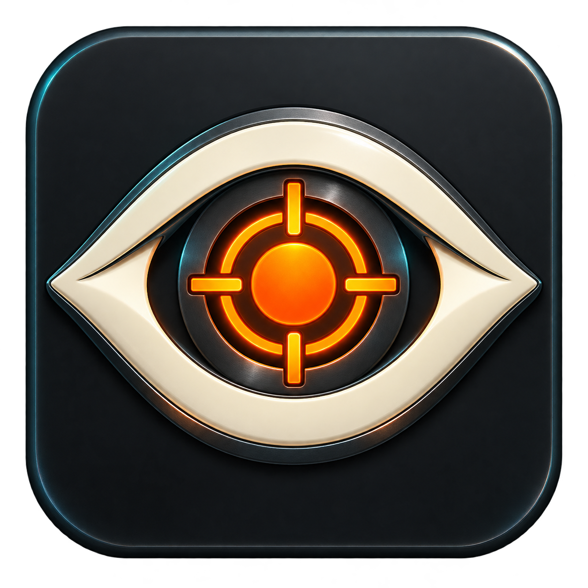
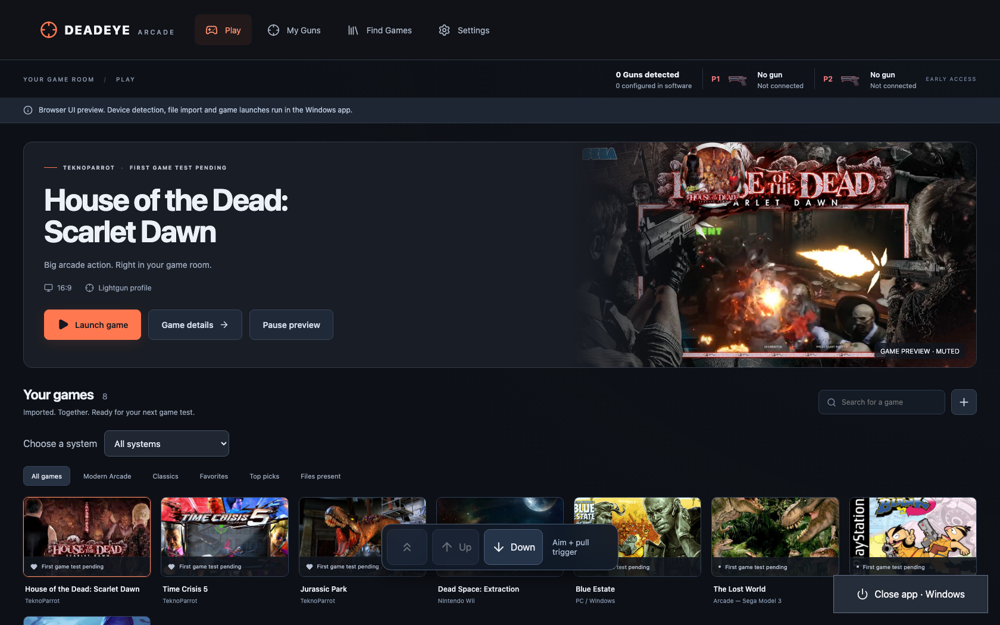
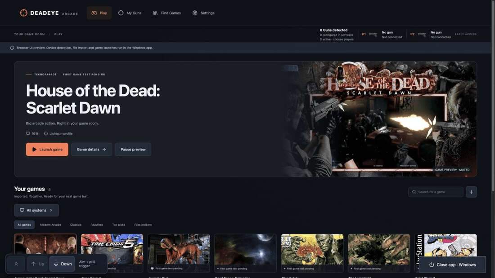
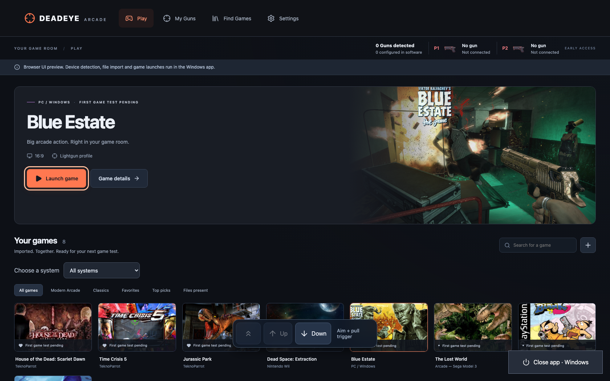
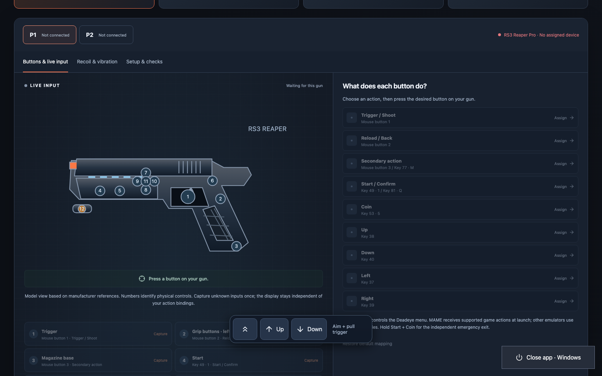
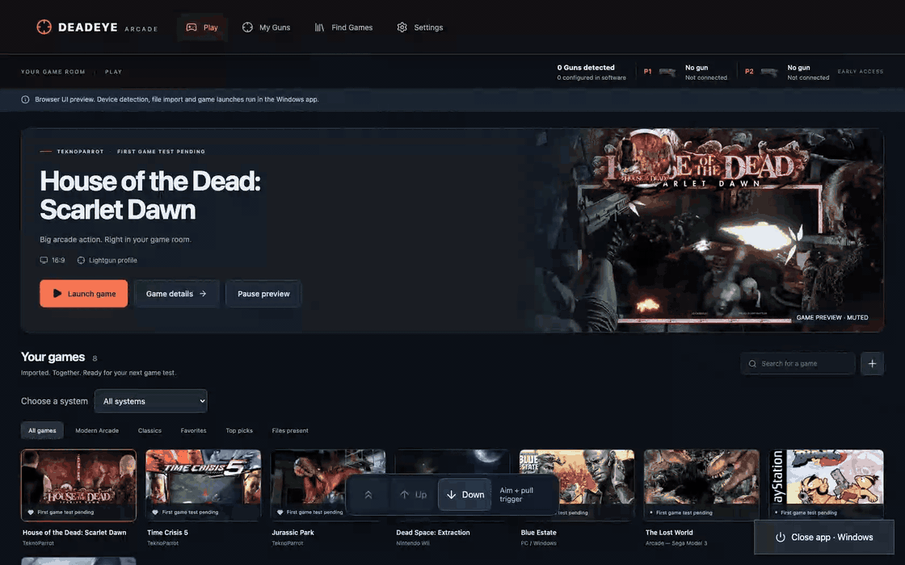
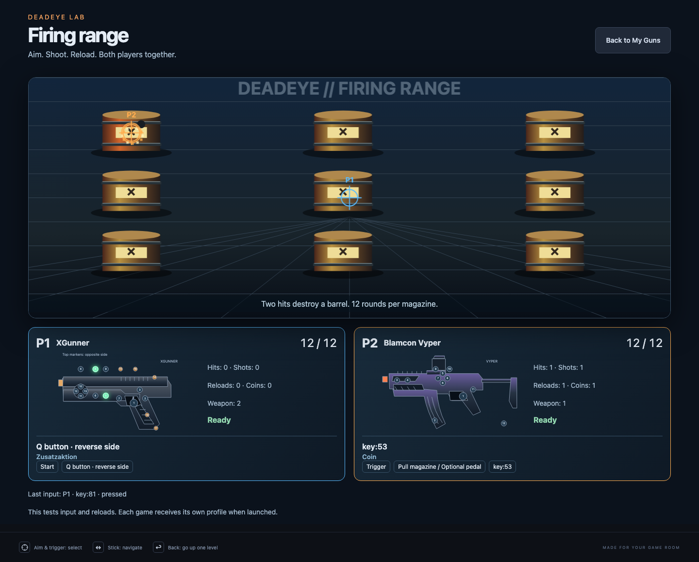

# Deadeye Arcade



**Your lightguns. Your games. One Windows arcade.**

Turn your Windows PC into a fullscreen lightgun game room. Browse covers and video
previews, set up your guns, let Deadeye handle supported game profiles and common
setup problems, and return to the library with your gun.

[](LICENSE)
[](https://github.com/sthamann/deadeye-arcade/releases/latest)
[](#language)

**[Download the latest Windows installer](https://github.com/sthamann/deadeye-arcade/releases/latest)** · [Portable downloads and checksums](https://github.com/sthamann/deadeye-arcade/releases)

## What Deadeye does

- **Browse and launch with your gun:** a fullscreen library with covers, video
  previews, screenshots, search, favorites and gun navigation.
- **Choose the guns you want to play with:** assign connected devices to P1/P2,
  mix supported families and leave additional guns in standby.
- **Set up the actual controls:** model illustrations, live button highlights,
  guided capture and saved action bindings for each physical gun.
- **Try them immediately:** an integrated firing range for one or two players,
  with destructible barrels, ammunition, reload and visible input feedback.
- **Prepare supported games automatically:** player assignments, emulator profiles,
  recognized multiplayer integrations, runtime checks and reviewed repair rules.
- **Keep the way out clear:** a controls introduction, in-game menu, independent
  emergency exit and a persistent button back to Windows. Pending launches are
  cancelled when you close the app; repeated launch requests are ignored while a
  session is being prepared or running.

[Supported lightguns](#supported-lightguns) · [Firing range](#try-your-guns-before-launching-a-game) · [Game profiles](#how-gun-profiles-reach-your-games) · [Windows setup](#get-started-on-windows)

## See it in action





**[Download the full-resolution UI video](docs/images/deadeye-library.mp4)**

*Captured from the running frontend with a curated selection of game artwork and
preview clips. The video plays inside the app; these are UI recordings, not mockups.
Original game-media files are not bundled as library assets.*



*Blue Estate screenshot reference: [official Steam store](https://store.steampowered.com/app/305380/Blue_Estate_The_Game/). Game artwork belongs to its respective owners.*





*Gun Studio is shown in browser preview without simulating connected hardware.*

## Your game room

- **A library made for the big screen:** search, favorites, platform filters and a
  featured game with a launch button. Aim at the fixed **Up / Down** buttons and
  pull the trigger to scroll. Selecting a cover returns to the featured game.
- **Artwork and previews:** local covers, muted game-video previews, screenshots
  and logos. Download missing covers with an optional SteamGridDB API key or
  choose your own artwork.
- **Useful game details:** English descriptions, release years and original
  hardware when available, plus controls, setup requirements and separate launch
  and gameplay status. Imports preserve existing enriched information.
- **Your existing games:** import TeknoParrot profiles, scan available MAME ROMs
  against the installed emulator's catalog, add Windows game applications or
  import a collection JSON. Existing favorites and media are retained.
- **An arcade look throughout:** an original app icon for Windows, Setup and
  shortcuts, with a matching dark desktop wallpaper. [Artwork and wallpaper](docs/branding.md).

## Verify your library

The built-in library check launches games one at a time through the same setup
and input path used by the frontend. Loading time is separate from observation:
a game gets a full 15 seconds after its visible game window appears. Each test
checks process ownership, foreground focus and cleanup, then reads the active
control profiles for the selected P1/P2 guns.

Window tracking follows a replacement renderer even when the original window
remains alive. Dolphin's running renderer is distinguished from its library and
configuration windows in both display modes, so raising its library does not
redirect the game overlay. Replacing the renderer starts a fresh observation interval.

Launch results and control completeness are recorded separately. Required
controls come from the installed MAME driver's input metadata, the selected
TeknoParrot vendor template, reviewed Wii title requirements and the supported Time
Crisis 5 helper. Other systems stay marked for review until their complete
required-action list is known. A generic button list never certifies a title's
full controls. Software checks do not mark physical aim, recoil or cooperative
play as tested.

For maintenance, close the frontend and run `ReaperArcade.exe --test-library`.
Each game report includes a button simulation alongside its launch result.
Run `ReaperArcade.exe --simulate-controls` to check the entire library without
launching games. The report in `controls-simulation.json` records the smallest
physical button combination for each readable action and separation from the
other player's controls. Dolphin DSU profiles replay button press, repeat and
release events through the production input bridge and decode its actual output
frames, including combined and negated actions. Other supported profiles use
expression simulation, labeled `profile-routed`; their consumer transition
results remain unset. Unknown syntax, missing captures, shared keyboard
collisions, conflicting special actions and incomplete required-action lists stay open.
RetroArch keeps alternative bindings for each action and reports offscreen
shooting separately from reload. Simulation never
marks a game's reaction, physical tracking or feedback as verified.

Flycast writes a separate mouse and keyboard profile for each selected gun.
Trigger, offscreen reload, the secondary action, Start, credits and directions
follow the saved gun assignments. A Vyper magazine captured as a keyboard input
is supported alongside its mouse buttons. The controls reference and simulation
read these base device profiles and check their player ports. Conflicting physical
bindings are rejected before files change. Game specific Flycast overrides and
complete per-title action requirements remain marked for review.

For imported Naomi and Atomiswave entries that point at a CHD folder, Deadeye
selects the exact same-named arcade ZIP beside that folder when it exists.
It keeps the disc folder as a requirement, validates the archive before launch
and includes the selected archive in resume checks. An unrelated neighboring
archive is never substituted. Dreamcast disc entries retain their own launch path.

Game specific TeknoParrot routes also map Gashaaaan Throw to each player's
trigger and Too Spicy's separate movement pedals to the captured left and right
controls. Exact native action identifiers keep these routes separate from other
games that share an emulation profile. For supported Aliens launch paths, the
owned Game Running status window is minimized once the game renderer is ready.

The original 32 bit Windows House of the Dead 2 has a reviewed graphics repair.
For `HOD2.EXE` using DirectDraw, Deadeye downloads the exact official DDrawCompat
0.7.2 package when the wrapper is missing and disables its T&L device with
`SupportedDevices = hal`. Package and DLL hashes are verified, the upstream
license is retained, and existing display preferences are preserved with a backup.
Unknown installed wrappers remain untouched and are flagged for review. The
wrapper and its settings also invalidate stale resume results when changed.
This repairs the graphics startup path; player setup and gameplay remain separate
checks.

Use `--test-library --resume` to keep successful results whose app version,
gun assignments and relevant files still match. Resume first reaches titles
left untested by an interrupted run, then retries failures. Its cumulative attempt
list survives further interruptions, so each resume can continue reaching new titles. Executables and
libraries are fingerprinted by content, including patches that preserve file
size and timestamps.
**Start + Coin** or **F12** stops the run, including between games;
`ReaperArcade.exe --stop-library-test` also stops it.

Results are saved after every title in `%LOCALAPPDATA%\ReaperArcade\library-test.json`
and the individual `game-test-*.json` files. A bounded supervisor stops stuck
workers and their owned process trees, so one failed game cannot leave the
entire run waiting indefinitely. Saved gun settings are restored after a forced
worker stop; a failed restore stops the batch for attention.

A lingering modal Windows dialog also stops the run for attention. Critical
loader errors are returned to the process, preventing orphaned error boxes from
interfering with later games. Code Integrity checks report the blocked file and
policy when Windows rejects a game or emulator component. Deadeye does not
change that security policy automatically.
Standard dialog messages are retained in the local report, including the error
body, to make missing-runtime and startup problems easier to diagnose.

Exact game action routes cover supported special inputs such as Castlevania’s
red/yellow whip buttons and Let’s Go Island 3D’s left/right trigger variants.
Mars Sortie's weapon change is routed separately for each selected gun.
Cabinet test-menu directions and explicitly labeled skip-game debug controls
are excluded from required gameplay actions; real selection controls remain included.
The reviewed Wii profiles are checked across all sixteen model pairings in
software. Physical button presses and in-game reactions still require hardware
verification.

MAME checks include global and per-game overrides, preserving their unrelated
settings and backing up changed input files. Time Crisis 5's reviewed helper is
adapted to the selected gun for credits, both pedals, weapon change and crosshair.
Custom helpers are retained for review. TeknoParrot checks compare the active
profile with the independent template shipped by the emulator, keep managed pedal
routes aligned with the selected guns while preserving explicit external pedals, detect missing
rows and stale action identifiers, and restore supported routes with backups.
Aim routes are checked against the exact physical gun for each player. Unknown
action ownership stays pending. Each game report records the app version and
the exact tested gun assignments. Per-configuration results are retained under
`%LOCALAPPDATA%\ReaperArcade\test-history`, so testing another gun pair does
not erase previous evidence. Changing profiles, helpers or assignments
invalidates a retained result. Equal keyboard codes shared by two RetroArch
guns are reported as a player isolation problem.

## Supported lightguns

Deadeye supports four hardware families. **My Guns** combines detection, P1/P2
selection, physical controls, calibration guidance and software preparation.

| Model | Controls represented in Deadeye | Setup integration |
| --- | --- | --- |
| **RS3 Reaper Pro** | Trigger, grip reload buttons, magazine base, Start/Coin, side button and stick with press | Windows HID/COM detection, manufacturer calibration module, aspect/offscreen settings and separate recoil/rumble tests |
| **Sinden Lightgun** | Trigger, pump, four side buttons and four D-pad directions | Manufacturer software preparation, runtime checks, guided control capture and supported game profiles |
| **X-Gunner Wireless** | Trigger, right/middle mouse inputs, Start/Coin, Space, Q/E, opposite-side Enter and directional stick | Receiver identification, manufacturer configuration tool, onboard calibration guide and local feedback tests |
| **Blamcon Vyper** | Trigger, A/B, magazine pull, Start/Select, stick directions, optional pedal and auxiliary selector input | ARC through Steam, native configuration, saved calibration profile selection and local recoil/rumble tests |

### Choose P1 and P2

Every detected device gets its own card. Select **Use for P1** or **Use for P2**;
selecting a gun already used by the other player swaps their slots. **Sit out**
removes it from active play while keeping its settings. More than two devices can
remain connected, and the two selected guns can be different models.

A game slot is separate from a receiver's hardware player number. Reassigning a
gun to game P1 does not rewrite its hardware ID. Explicit selections and per-gun
button/feedback settings survive reconnects, restarts and updates.

The header shows the detected count, active P1/P2 models and setup status. USB
presence, software preparation and a received button event have separate states.
For wireless hardware, detecting the receiver alone does not confirm a gun is
awake and sending inputs. Deadeye renews its input registrations after Windows
unlock, resume and Remote Desktop transitions. Recovery clears stale button-test
locks and pressed-button highlights so old input state cannot block the menu.

### Physical buttons and action bindings

Each family has its own illustrated controls, shared by Gun Studio and the native
startup overlay. Press a button to highlight its physical position. Opposite-side
controls and mechanical switches are labelled separately.

**Capture** learns which signal a physical control sends. **Bind** chooses what that
signal does. This separation keeps the picture accurate when you change actions.
The guided menu setup requests each control in sequence, requires release before
the next step and rejects duplicate signals. Unknown controls remain visible until
captured; restoring default actions preserves the captured physical signals.

Use **Start button test** to inspect a gun without its normal frontend menu actions
firing. Other guns can still operate the menu, and the fixed Windows exit stays
available. Shortcuts implemented inside the gun's own firmware still apply.

The D-pad or stick moves focus through games and menus; holding a direction keeps
moving and scrolls the focused item into view. Aim and trigger also work with the
fixed scrolling buttons. Selecting a cover returns to the featured game and its
launch button. The system filter opens large buttons that work with gun aiming,
trigger selection and directional navigation. Menu hints use the selected gun's
saved physical controls. Keyboard navigation follows local and Remote Desktop
mode changes without restarting the frontend.

### RS3 Reaper Pro

- **Default actions:** trigger shoots, the grip buttons reload and the magazine
  base supplies the second action. Start/Coin, side button and stick inputs follow
  the gun's actual hardware player number, including the different P2 key codes.
  Both grip reload buttons share one signal.
- **Software:** normal mouse/keyboard input uses Windows HID. Deadeye groups the
  gun's interfaces, finds its COM port and prepares the checked manufacturer
  calibration module when required.
- **Calibration:** run the integrated fullscreen four-target calibration for the
  selected gun, then the separate five-target aim test at the physical monitor.
- **Configuration and feedback:** mouse mode, 16:9/4:3, offscreen reload and bounded
  recoil/rumble test pulses. Recoil and grip rumble are separate mechanisms. The
  hardware switches and specified power supply govern mechanical recoil; Deadeye
  does not provide an undocumented continuous force slider.

### Sinden Lightgun

- **Controls:** trigger, pump, four side buttons and four D-pad directions. The
  pump is the reload control; captured side buttons supply Start, Coin and the
  additional actions used by supported profiles.
- **Guided setup:** capture all nine non-trigger controls from your own vendor
  configuration. Sinden can send different inputs on-screen and off-screen, so
  capture the intended on-screen signals. Deadeye does not guess RS3 key codes.
- **Software:** prepares the reviewed Sinden package, scans its programs for
  supported Microsoft runtimes and checks again after dependency installation.
  A fresh vendor configuration enables automatic detection/start and the border;
  vendor confirmations remain visible.
- **Tracking and feedback:** the manufacturer software handles camera tracking,
  the screen border, start/stop, calibration and supported recoil settings. Fully
  captured Sinden controls can use Deadeye's separate per-player Dolphin bridge
  for supported Wii profiles.

### X-Gunner Wireless

- **Detection:** identifies the XGUNNER receiver even when Windows supplies generic
  mouse or keyboard names. The receiver's hardware number remains separate from
  its selected game slot.
- **Default actions:** trigger shoots; right mouse or Space reloads; middle mouse
  and Q/E provide second-action inputs. Start/Enter confirm, Coin provides credit
  and the WASD directional stick drives frontend navigation. Individual signals
  remain visible and can be recaptured if the vendor mapping changes.
- **Physical layout:** Enter is a separate button on the opposite side. Power,
  vibration, rapid-fire and firmware controls are identified as hardware controls.
  The documented magazine release is mechanical; the manual does not specify an
  independent HID signal for it. Reload uses the documented button inputs.
- **Software and calibration:** prepares the reviewed manufacturer configuration
  tool and its supported runtimes. The onboard calibration guide covers IR layout
  and target order; lightgun mode and aspect selection are available in setup.
- **Feedback:** separate bounded solenoid and motor test pulses, followed by
  automatic-mode restoration. The gun's physical vibration and rapid-fire
  switches remain relevant. Reviewed TeknoParrot and Dolphin routes support mixed
  assignments with other supported families.

### Blamcon Vyper

- **Pointer setup:** detection restores Mouse/Keyboard mode before the first game.
  **Restore mouse pointer** repeats this without changing calibration or feedback.
  With four RS3 emitters at the screen edges, select **Crosshair** under ARC
  Tracking, check all four points in Live View, then calibrate. Buttons responding
  alone do not confirm working camera tracking.
- **Default actions:** trigger shoots, **magazine pull reloads**, A is the second
  action and B is the third action. The magazine microswitch uses the FOOT channel,
  defaulting to keyboard R in assignable mode. An optional pedal shares this
  channel; identical signals cannot be distinguished as separate controls.
- **Automatic button setup:** supported firmware 2.x supplies its actual saved
  Start, Select, directions, trigger, A/B and magazine keys over USB. Deadeye
  selects Mouse/Keyboard mode and, for initial setup, an independent magazine
  channel. Later scans preserve a saved gun profile even when that gun is sitting
  out. It reads the result back, then uses it for menu navigation, the emergency chord and game
  profiles. Custom action assignments survive
  simultaneous ARC key swaps. Changing the magazine key or returning the selector
  to recoil mode removes obsolete input assignments. Gun Studio capture remains
  available for unsupported key combinations. The two-stage mechanical trigger
  has one electrical shoot input.
- **Native settings:** mouse/keyboard mode, 16:9/4:3, offscreen-reload behavior,
  off/semi/automatic recoil, magazine/pedal mode and one of four existing
  calibration profiles. Per-game settings restore the saved menu settings on exit.
- **Software and calibration:** installs or opens official Blamcon ARC through
  Steam. Login or installation confirmation remains visible when needed. ARC
  covers calibration, camera view, IR sensitivity, smoothing, rumble strength and
  further vendor settings; tracking and calibration are stored onboard.
- **Two guns and feedback:** use separate hardware player IDs for two Vypers,
  then assign their game slots in Deadeye. Bounded local recoil/rumble tests are
  available. No firmware flash, factory reset or calibration overwrite happens
  automatically.

[Detailed physical controls, shared signals and manufacturer references](docs/HARDWARE-CONTROLS.md) · [Gun Studio walkthrough](docs/gun-studio.md) · [Calibration guide](docs/compatibility.md)

The menu shows separate P1 and P2 aim cursors, so moving one gun keeps the
other player's last position visible. Player reassignment and game transitions
clear stale positions.

### How gun profiles reach your games

The supported launch path reads the currently assigned physical guns and prepares
the game's input files before starting it. Common actions follow the saved Studio
bindings; additional title functions use their reviewed control routes. The active
profile supplies the startup controls reference.

| Integration | How player controls are applied |
| --- | --- |
| **MAME** | Separate gun mice and raw keyboards for P1/P2. Identical Start/Coin key codes from mixed families keep their own player channels. Supported action routes include the Vyper's separate A/B actions. |
| **TeknoParrot RawInput** | Writes assigned device paths and supported mouse/key actions into the selected profile. Named title actions such as weapon change and pedals follow their reviewed routes. Inactive players and removed actions lose their old input routes. Vyper weapon change uses learned D-pad Down when its selector is reserved for recoil. |
| **Dolphin / Wii** | Uses a matching disc-region accuracy profile and the gun's captured controls. Independent bridge channels carry each player's aim and buttons, including supported mixed pairs and fully captured Sinden controls. |
| **Standalone RPCS3** | Prepares supported Raw Mouse / PS Move profiles with separate physical inputs and additional button channels. |
| **RetroArch and Supermodel** | Generates supported device/action routes from the current assignment. A captured magazine reload takes priority over a retained pedal alias. The controls check flags shared RetroArch keyboard codes rather than treating equal keys as isolated player inputs. |
| **Recognized multiplayer plugins** | Prepares each installed integration's required device format. Blue Estate and HOTD 2: Remake fixed mouse layouts temporarily switch the Vyper magazine channel to right mouse, then restore its saved mode. |

The bulk controls repair uses the same Dolphin model support and bridge policy
as game launch, including Vyper, XGunner and supported mixed pairs. The report
checks the written files and identifies remaining actions; it does not mark a
game as physically tested.

Fixed mouse layouts are not arbitrary remapping systems. The controls reference
shows their required bindings, and patches must match the installed game build.
DemulShooter and Hook of the Reaper can run as configured session helpers for
compatible games; game-driven recoil needs a matching output integration.

Independent P2 input depends on the game, emulator and installed integration. The
status distinguishes configuration, launch checks and confirmed gameplay. See the
[emulator table](#emulator-support) and [game-specific guide](docs/compatibility.md)
for supported paths and remaining requirements.

## Try your guns before launching a game

Open **My Guns → Firing range** without installing a game. It uses the currently
assigned connected guns, including mixed P1/P2 setups.

- **A small shooting game:** nine barrels, two hits to destroy each barrel, impact
  effects and targets that return for another round.
- **Separate players:** blue P1 and amber P2 crosshairs, twelve rounds per magazine,
  shots, hits and reload counts. One player's input does not consume the other's
  ammunition or reload their gun.
- **Reload and extra actions:** try the magazine pull, pump or assigned reload
  button. Second/third/mode actions cycle the displayed weapon selection. The
  range shows Coin counts and received Start inputs too.
- **Live control feedback:** a model illustration highlights held buttons, shows
  the latest physical control and assigned action, and lists controls seen during
  the test. Received inputs are visible even when they have no assigned action.
- **A clear return:** Start and Coin do not leave the range. Aim and trigger at
  **Back to My Guns**, or use the persistent **Close app · Windows** button.

The range checks aim and input delivery; it does not perform hardware calibration
or prove a title's multiplayer/feedback integration. Its ammunition and hit effects
do not drive game-event recoil. Physical gun testing uses the connected monitor;
Remote Desktop shows an explicit local-test notice. The browser preview provides
a separate mouse-operated demonstration.



*UI test fixture with XGunner P1 and Vyper P2. Hardware gameplay is checked at the
physical display.*

## Automatic setup and repairs

Deadeye carries **17 reviewed rules** for common setup pitfalls. It checks the
library at startup and after import, then rechecks the selected game before launch.
Supported input profiles are prepared from the assigned guns as part of the actual
launch path.

| What Deadeye recognizes | What it does |
| --- | --- |
| Moved TeknoParrot game files | Repairs an unambiguous existing game path and preserves the original profile. |
| Broken portable emulator paths | Repairs supported Model 2 search paths, inaccessible PCSX2 memory-card storage and matching TeknoParrot metadata. |
| Missing OpenAL or Hypseus support files | Downloads exact reviewed official packages, checks hashes and compatibility, and restores eligible absent files with their licenses. |
| P1/P2 input assignments | Prepares supported MAME, TeknoParrot, DemulShooter, RetroArch, Flycast, Supermodel, RPCS3 and Dolphin input paths. |
| Supported Dolphin games | Matches the actual disc region to a reviewed accuracy profile, preserves learned offsets and prepares separate per-gun DSU channels for supported two-gun setups. Dead Space Extraction uses Hybrid Ubershaders. |
| Recognized installed multiplayer extensions | Configures matching Blue Estate and HOTD 2: Remake inputs using each extension's actual device format. |
| Supported game-specific profiles | Applies known Aliens and Model 2 presentation settings, reads the reviewed Time Crisis 5 controls helper and prepares specific installed arcade-loader libraries. |
| Required Windows runtimes | Inspects launch programs and local libraries; offers matching Visual C++, DirectX and .NET components from Microsoft with architecture and signature checks. |
| Missing files or access requirements | Identifies the affected game and remaining step, including vendor access, Windows elevation and shared PCSX2 pointers. |

Open **Settings → Automatic repairs** to inspect results, next steps, known pitfalls
and recent changes, or select **Check and repair library**. Repairs and launch-time
profile changes are recorded locally; changed profile files include before/after
hashes. Repeated checks leave healthy files unchanged. New reviewed rules arrive
through normal app updates. [Automatic repair guide](docs/automatic-repairs.md).

Manufacturer logins, Windows consent, installer license prompts and physical
calibration can require your interaction. Game files and matching multiplayer
patches must be supplied separately; Deadeye configures recognized installed
integrations rather than treating every patch as compatible.

## Play with your gun

When the game window becomes visible, a **ten-second controls introduction** shows
your gun and the actions from the active profile. The game keeps input focus and
the introduction disappears automatically. The controls reference reads supported
emulator and helper profiles for each player; unresolved inputs stay visible.
Windowed and borderless presentation supports desktop overlays; exclusive
fullscreen can cover them.

| Action | Gun or keyboard control |
| --- | --- |
| Browse the library | Aim and trigger; stick navigation and fixed scrolling buttons are also available. |
| Return from a game | Hold **Start + Coin** on the assigned gun for about **two seconds**. Keyboard: **F12**. |
| Open the in-game menu | Hold the assigned trigger for **at least ten seconds**, then release. Keyboard: **F10**. Autofire can interrupt this hold; Start + Coin is the primary emergency gesture. |
| Resume, restart or end a game | Select the corresponding in-game menu action, or use D-pad navigation and Start to confirm. |
| Close Deadeye and return to Windows | Select the persistent **Close app · Windows** button. After returning from a game, release Start/Coin and hold them again in the frontend to close it. |

Game sessions reserve a single launch and supervise their own process tree to
prevent duplicate starts and clean up owned games and helpers on exit. Emergency
exit detection runs independently of the frontend UI thread. The native close
button remains available during dialogs, button testing and background checks.
The in-game menu does not automatically pause the game; timers and audio may continue.
[In-game menu details](docs/in-game-overlay.md).

Optional **blue P1/P2 desktop crosshairs** follow assigned absolute-input guns over
Windows Desktop and Explorer. They pass clicks through, hide over games and other
applications, and can remain active with the frontend closed. Windows still has
one shared system click pointer.

## Emulator support

| System | Current integration | Game-specific setup to check |
| --- | --- | --- |
| TeknoParrot | Profile import, path repair, supported RawInput gun bindings, controls reference and supervised launch | Vendor access, required elevation, special pedals/actions and matching helper/output configuration |
| MAME | Import from the emulator's lightgun catalog and present ROM archives, generated controller mapping and controls reference | Game overrides, service calibration and ROM compatibility |
| Dolphin / Wii | Region-matched accuracy profiles, model-specific controls and independent native DSU inputs for supported gun assignments | Supported disc ID, physical aiming and each game's actions; other regions retain existing settings |
| RetroArch | Explicit player-device assignments and supported core profiles | Core-specific controls and overrides |
| Flycast | Per-device RawInput mapping for supported launch paths | Correct content, emulator build and game calibration |
| Supermodel | Live RawInput mouse/keyboard assignment, including supported title overrides | Service calibration and actual simultaneous gameplay |
| Standalone RPCS3 | Raw Mouse / PS Move configuration on recent compatible builds | Per-player game calibration; bundled TeknoParrot RPCS3 is a separate path |
| Model 2 | ROM search paths, supported presentation and installed DemulShooter setup | Matching helper target and service calibration |
| PCSX2 | Portable storage repair, launch paths and detection of shared GunCon2 pointers | A shared Windows pointer does not provide independent two-gun play |
| Other Windows games and emulators | Manual or collection-import launch paths, configured helpers and runtime inspection | Build-specific plugins, input adapters and per-title requirements |

Automatic import and input configuration differ by system. **Early access:**
software setup and launch checks are separate from verified aiming, independent
P2 inputs and recoil. Deadeye keeps these statuses distinct; a successful launch
is not a full playthrough. [Game-specific compatibility guide](docs/compatibility.md).

## Get started on Windows

1. Download **Deadeye Arcade Setup** and run it. It installs for your Windows user
   and adds desktop and Start menu shortcuts. The .NET runtime is included; Setup
   installs Microsoft Edge WebView2 Runtime if needed, using an Internet connection.
2. Connect your guns and open **My Guns**. Inspect player assignment, prepare the
   supported software and check the live physical buttons. Run guided capture for
   unknown controls before relying on menu shortcuts or generated game profiles.
3. Calibrate at the physical monitor. For RS3, run the integrated four-target
   calibration followed by the separate aim test.
4. Open **Firing range**. Test shooting, reload, extra buttons and each selected
   player separately, then together.
5. Use **Find Games** to import supported profiles, scan MAME games or add an
   existing Windows application or collection JSON.
6. Review **Settings → Automatic repairs**, then launch a game. Check aiming,
   actions and both players before confirming gameplay in Game Details.
7. Hold **Start + Coin** to return to the library, or use the in-game menu.

Fullscreen is on by default. **Start with Windows is off by default** and can be
changed in Settings. Desktop crosshairs have a separate background startup entry,
enabled by default and controlled by their own toggle.

Games, ROMs, emulators and manufacturer utilities are not bundled. Setup and the
portable package are not code-signed. Uninstall removes app files and shortcuts
while retaining your library, settings and media.

### Language

**English is the default.** Select **Settings → Language → English / Deutsch** to
change the frontend, native menu, dialogs and app messages. The choice survives
restart and updates. Game titles, user notes, paths and external manufacturer or
emulator interfaces retain their original language.
[Localization details](docs/localization.md).

## Updates, local data and diagnostics

Deadeye checks stable GitHub releases at startup and every six hours. Open
**Settings → App updates → Install update and restart** when an update is available.
The installer download is checked against GitHub's SHA-256 digest and expected size.
Deadeye backs up the library, updates in place and reopens with your games, gun
mappings, language and startup preferences preserved. Updates cannot be installed
while a game is running. Automatic checks can be disabled; manual checks remain
available. [Installer and updater details](docs/updates.md).

The library, settings and repair reports live under `%LOCALAPPDATA%\ReaperArcade`.
The optional SteamGridDB API key uses Windows user-bound encryption. Diagnostic
export includes device assignments, game status, repair findings and recent changes,
with API keys excluded. Repair and update checks do not upload your library or gun
data. The executable and storage names remain `ReaperArcade` for compatibility.

Display diagnostics record current and saved Windows modes and distinguish Remote
Desktop from local sessions. With desktop crosshairs enabled, the companion also
records mode transitions while the frontend is closed. An RDP refresh rate does
not establish the physical TV's refresh rate, and calibration requires the physical
screen.

With the frontend closed, these commands operate on the current Windows user's library:

```powershell
ReaperArcade.exe --import-collection "C:\path\to\spiele.json"
ReaperArcade.exe --repair-library
ReaperArcade.exe --inspect-display
ReaperArcade.exe --validate-library
ReaperArcade.exe --check-dependencies
ReaperArcade.exe --inspect-guns
```

Runtime inspection covers known executable imports and .NET configurations.
Dynamically loaded plugins, drivers and special library search paths can require
additional setup. Unknown DLLs are never downloaded from DLL portals.

## Build and contribute

Requirements: **Node.js** and **.NET SDK 10**.

```sh
cd ui
npm ci
npm run build
cd ..
dotnet run --project src/Reaper.Checks -c Release
dotnet publish src/Reaper.Windows -c Release -r win-x64 --self-contained true -o release/windows-x64
```

Keep the complete publish output, including `web/`. The installer build also needs
NSIS (`makensis.exe`) and Internet access for the Microsoft bootstrapper. On Windows,
[`scripts/build-windows.ps1`](scripts/build-windows.ps1) builds and packages the portable app.
The application is native WPF with a locally packaged React/WebView2 interface;
it does not require a local web server in normal Windows use.

For the browser preview and its checks:

```sh
cd ui
npx playwright install chromium
npm run dev -- --port 5199
# In a second terminal, from the repository root:
node scripts/check-ui.cjs
node scripts/check-gun-navigation.cjs
node scripts/check-blamcon.cjs
node scripts/check-range.cjs
```

The range check uses Node.js 24 or newer to load its TypeScript game logic. UI
checks exercise mixed player inputs, reload isolation, model highlights, return
controls and responsive layouts. They do not certify physical gun accuracy.

The preview demonstrates the interface without performing hardware or file operations.
UI and native code share [`localization/en.json`](localization/en.json). German source
messages are the keys; English translations are the values. Keep numbered placeholders
and surrounding spaces intact. [Localization details](docs/localization.md).

Further reading: [architecture](docs/architecture.md), [Gun Studio](docs/gun-studio.md),
[automatic repairs](docs/automatic-repairs.md), [compatibility](docs/compatibility.md)
and [third-party components](THIRD-PARTY.md). Some detailed implementation notes
are in German.

## License

Deadeye Arcade's application code is licensed under the **[MIT License](LICENSE)**.
Third-party runtimes and components retain their own terms; see
[THIRD-PARTY.md](THIRD-PARTY.md) and the packaged `licenses/` folder.
